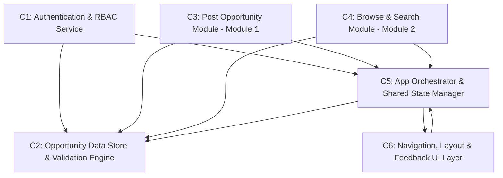

# Secure Software Development (SSD)
## Semester Project — Development Activity 4 Submission
### Dependency Mapping and Failure Analysis

---

### 1. Project Information

* **Project Name:** SafeHire: Verified Credential & Skill-Match Recruitment Portal
* **Course:** Secure Software Development (SSD)
* **Institution:** National University of Computer & Emerging Sciences (FAST-NUCES), Lahore Campus
* **Semester:** Fall 2026
* **Live Deployment URL:** [https://safehire-secdev.vercel.app/](https://safehire-secdev.vercel.app/)
* **GitHub Repository URL:** [https://github.com/muhammadumarafzaal/safehire-secdev](https://github.com/muhammadumarafzaal/safehire-secdev)
* **Local Run Command:** `npm run dev` (Runs locally on `http://localhost:3000/` without requiring external backend or internet connection)

#### Group Members:
1. **Muhammad Umar Afzaal — Roll No: 23F-3106**
2. **Musa Rehan — Roll No: 23F-3093**

---

### Part 1 — Identify Your System Components

**Your Project:** SafeHire: Verified Credential & Skill-Match Recruitment Portal

| Symbol | Component Name | Main Responsibility |
| :--- | :--- | :--- |
| **C1** | **Authentication & Role-Based Access Control Service** | Manages user login/logout, role selection (Student vs. Placement Officer), session state management, credential validation via demo user store, privacy consent enforcement, and protected route guardrails that prevent unauthenticated access to dashboards. |
| **C2** | **Opportunity Data Store & Validation Engine** | Serves as the centralized data layer holding verified internship listings (`opportunitiesData.js`), demo user credentials (`demoUsers.js`), domain categories, work modes, and all shared validation/sanitization utilities (`sanitizeInput`, `validateOpportunityForm`, `validateSearchQuery`, `generateOpportunityDigest`). |
| **C3** | **Post Verified Opportunity Module (Module 1)** | Provides the enterprise requisition interface enabling authorized users to compose, validate, cryptographically sign (SHA-256 HMAC digest), and publish new verified internship opportunities into the shared reactive state. |
| **C4** | **Browse & Search Opportunities Module (Module 2)** | Presents the full catalog explorer with real-time keyword search (with query sanitization & length guardrails), multi-facet filtering (domain, work mode, stipend), interactive cryptographic verification proof inspection modal, and bookmark state machine. |
| **C5** | **Application Orchestrator & Shared State Manager (App Root)** | Acts as the central orchestrator (`App.jsx`) managing global reactive state (opportunities array, user session, toast notifications, audit drawer), page routing, cross-module data flow, and component composition/rendering. |
| **C6** | **Navigation, Layout & Feedback UI Layer** | Encompasses the Navbar (with role-aware links and logout), Footer (with cross-module navigation), Toast notification stack, Audit Ledger Drawer, and the Design Token System (`tokens.css`) that enforces visual consistency across all pages. |

---

### Part 2 — Identify Direct Dependencies

| Component | Directly Depends On | Reason |
| :--- | :--- | :--- |
| **C1** (Authentication & RBAC) | **C2** (Data Store) | The login page imports and validates credentials against `DEMO_USERS` from the data store; without C2, no credential lookup or role definitions are available. |
| **C1** (Authentication & RBAC) | **C5** (App Orchestrator) | C1 depends on the `setUser` and `setCurrentPage` callbacks provided by the App Orchestrator to persist the authenticated session and trigger page transitions. |
| **C2** (Data Store & Validation) | *(None)* | C2 is a self-contained data and utility module with no runtime dependencies on other components; it exports static data arrays and pure validation functions. |
| **C3** (Post Opportunity Module) | **C2** (Data Store) | C3 invokes `validateOpportunityForm()`, `sanitizeInput()`, and `generateOpportunityDigest()` from C2 to validate requisition inputs and produce cryptographic signatures. |
| **C3** (Post Opportunity Module) | **C5** (App Orchestrator) | C3 calls the `onAddOpportunity` callback (passed from App) to commit new postings into the centralized shared opportunities array. |
| **C4** (Browse & Search Module) | **C2** (Data Store) | C4 uses `validateSearchQuery()` from C2 to sanitize search terms, and reads `CATEGORIES` and `WORK_MODES` to render filter pill controls. |
| **C4** (Browse & Search Module) | **C5** (App Orchestrator) | C4 receives the live `opportunities` array as a prop from the App Orchestrator; without this prop, no listings can be displayed. |
| **C5** (App Orchestrator) | **C2** (Data Store) | C5 imports `INITIAL_OPPORTUNITIES` from C2 to initialize the shared opportunities state, and imports `DEMO_USERS` to set the default authenticated user on first render. |
| **C5** (App Orchestrator) | **C6** (UI Layer) | C5 composes C6 sub-components (Navbar, Footer, AuditDrawer, Toast) into the application shell; without C6, no navigation, layout chrome, or user feedback is rendered. |
| **C6** (UI Layer) | **C5** (App Orchestrator) | C6 components (Navbar, Toast, AuditDrawer) receive their state and callbacks (`currentPage`, `user`, `setCurrentPage`, `addToast`) as props from C5; they cannot function independently. |

---

### Part 3 — Construct the Dependency Matrix

**Reading:** Row component **depends on** Column component. A `1` in row Cx, column Cy means "Cx depends on Cy."

| Row / Column | **C1** | **C2** | **C3** | **C4** | **C5** | **C6** |
| :--- | :---: | :---: | :---: | :---: | :---: | :---: |
| **C1** | 0 | 1 | 0 | 0 | 1 | 0 |
| **C2** | 0 | 0 | 0 | 0 | 0 | 0 |
| **C3** | 0 | 1 | 0 | 0 | 1 | 0 |
| **C4** | 0 | 1 | 0 | 0 | 1 | 0 |
| **C5** | 0 | 1 | 0 | 0 | 0 | 1 |
| **C6** | 0 | 0 | 0 | 0 | 1 | 0 |

**Matrix Analysis Summary:**
- **Column sums** (how many components depend on each):
  - C1: 0 | C2: **4** | C3: 0 | C4: 0 | C5: **4** | C6: 1
- **Row sums** (how many dependencies each component has):
  - C1: 2 | C2: **0** | C3: 2 | C4: 2 | C5: 2 | C6: 1
- **C2** (Data Store) and **C5** (App Orchestrator) are tied as the most depended-upon components, each with **4 inbound dependencies**.
- **C2** is uniquely the only component with **zero outbound dependencies**, making it the foundational leaf node.

---

### Part 4 — Analyze Component Failures

#### Failure Scenario 1

* **Component that fails:** **C2 — Opportunity Data Store & Validation Engine**

* **Which components depend directly on it?**
  C1 (Authentication), C3 (Post Opportunity Module), C4 (Browse & Search Module), and C5 (App Orchestrator) all depend directly on C2.

* **Which additional components could be affected through indirect dependencies?**
  Since C5 depends on C2 and C6 depends on C5, the failure of C2 would cascade through C5 to also disable C6 (Navigation & Feedback UI Layer). Additionally, since C1, C3, and C4 all depend on both C2 and C5, the cascading failure through C5 reinforces their total unavailability. In effect, **every component in the system** is transitively affected by C2 failing.

* **Which system functions would be disrupted or degraded?**
  - **Total login failure:** No credential definitions exist, so no user can authenticate.
  - **No opportunity listings:** The initial dataset is undefined, so the browse catalog renders empty.
  - **No form validation:** `validateOpportunityForm()` and `sanitizeInput()` are unavailable, leaving the posting form without any security guardrails.
  - **No search sanitization:** `validateSearchQuery()` is unavailable, removing injection protection from the search bar.
  - **No cryptographic digest generation:** `generateOpportunityDigest()` cannot produce tamper-evident signatures for new postings.
  - **Complete application crash:** Since App.jsx cannot initialize `INITIAL_OPPORTUNITIES` or `DEMO_USERS`, the React render tree throws a runtime error at mount, resulting in a blank white page.

#### Failure Scenario 2

* **Component that fails:** **C5 — Application Orchestrator & Shared State Manager**

* **Which components depend directly on it?**
  C1 (Authentication), C3 (Post Opportunity Module), C4 (Browse & Search Module), and C6 (Navigation & UI Layer) all depend directly on C5.

* **Which additional components could be affected through indirect dependencies?**
  C5 is the root composition layer. Although C2 does not depend on C5, C2 becomes effectively useless in isolation because no component can import or render its data without the App Orchestrator wiring the data through props. There are no indirect paths beyond the direct ones because C5 sits at the top of the component tree, but the practical impact is **total system unavailability** since nothing renders without the root component.

* **Which system functions would be disrupted or degraded?**
  - **Complete render failure:** No pages are mounted; the browser shows a blank screen.
  - **Loss of shared state:** The reactive `opportunities[]` array, user session, and toast queue cease to exist.
  - **No page routing:** The hash-based page router (`currentPage` state) is unavailable, so navigation between Home, Login, Dashboard, Module 1, and Module 2 is impossible.
  - **No cross-module data flow:** Module 1 cannot dispatch newly posted opportunities to Module 2 because the `handleAddOpportunity` callback no longer exists.
  - **No authentication lifecycle:** Login, logout, and protected route enforcement all depend on C5's session state management.

---

### Part 5 — Identify a Critical Component

* **Selected Component:** **C2 — Opportunity Data Store & Validation Engine**

* **Which components depend directly on it?**
  C1 (Authentication & RBAC), C3 (Post Opportunity Module), C4 (Browse & Search Module), and C5 (Application Orchestrator) — a total of **4 out of 5** other components.

* **Why could its failure have a significant impact on your project?**
  C2 is the **foundational data layer** of the entire SafeHire platform. It is the only component with zero outbound dependencies and the highest inbound dependency count (tied with C5 at 4). However, C2 is **more critical than C5** for the following reasons:
  1. **C5 depends on C2**, but C2 does not depend on C5. This means C2's failure cascades upward to C5, which then cascades to C6, creating a **complete system collapse** through transitive dependency propagation.
  2. C2 provides **security-critical validation functions** (`sanitizeInput`, `validateSearchQuery`, `validateOpportunityForm`) that protect against XSS injection, ReDoS attacks, and data integrity violations. Its failure does not merely break functionality — it **removes security guardrails**, potentially allowing malicious payloads to propagate through the system if any component attempts to operate without validation.
  3. C2 is the **single source of truth** for all business data (opportunities, user credentials, domain categories). Unlike C5, which can theoretically be restructured or replaced by rewiring component composition, C2's data and validation logic are irreplaceable without fundamentally rewriting the application's business rules.

---

### Part 6 — Propose a Failure-Handling Strategy

* **Component that may fail:** **C2 — Opportunity Data Store & Validation Engine**

* **Proposed strategy:**
  Implement a **multi-layer graceful degradation and defensive fallback architecture** consisting of:
  1. **Embedded Fallback Defaults:** Each consuming component (C1, C3, C4, C5) should define local hardcoded fallback constants (empty arrays for opportunities, guest-mode user objects, inline basic validation rules) that activate automatically when the C2 import fails or returns `undefined`.
  2. **Safe Error Boundary Wrapper:** Wrap the React component tree in a top-level `ErrorBoundary` component that catches JavaScript runtime exceptions (such as failed imports or null references). Instead of a blank white page, render an informative error screen with a message like: *"SafeHire is experiencing a data layer issue. Core features are temporarily unavailable. Please refresh or contact support."*
  3. **Inline Validation Fallback:** If `validateOpportunityForm()` or `sanitizeInput()` are unavailable, the Post Opportunity form should **disable the submit button entirely** and display a warning: *"Submission temporarily disabled — security validation engine offline."* This ensures the system fails closed (denying potentially unsafe input) rather than failing open (accepting unsanitized data).
  4. **Monitoring and Alerting:** Log the data layer failure event to the browser console with a structured error object containing timestamp, component name, and failure type, enabling developers to diagnose the issue during development and testing.

* **How would this strategy reduce the impact of the failure?**
  The fallback defaults and error boundary prevent the **entire application from crashing**, allowing the Home Page, Navigation, and informational content to remain accessible. The inline validation fallback ensures the system **fails closed** from a security perspective — rather than silently accepting malicious input when validators are offline, the system explicitly blocks data submission. The monitoring strategy accelerates diagnosis and resolution, reducing mean time to recovery (MTTR).

* **Would the entire system need to stop, or could some functions continue?**
  The entire system would **not** need to stop. With the proposed strategy:
  - The **Home Page** and **Navigation UI** could continue to render static informational content (About SafeHire, feature descriptions, contact information).
  - The **Login Page** could display a graceful degradation message indicating that demo sign-in is temporarily unavailable, while still rendering the interface.
  - The **Post Opportunity** and **Browse Catalog** modules would be in a **read-only degraded mode**: the browse page would show an empty state with a clear message, and the post form would disable submission entirely.
  - Only the **data-dependent transactional operations** (posting new jobs, searching catalogs, verifying credentials) would be paused until C2 is restored.

---

### Part 7 — Dependency Graph

The following directed graph represents the dependency relationships among all 6 SafeHire system components. An arrow from component A to component B means "A depends on B."

```
                    +---------------------------------------------+
                    |  C2: Opportunity Data Store &                |
                    |      Validation Engine                       |
                    |  (Zero outbound dependencies -               |
                    |   Foundational Leaf Node)                    |
                    +--------+-----------+------------------------+
                             |           |
               +-------------+           +------------------+
               |             |           |                  |
               v             v           v                  v
    +--------------+  +--------------+  +--------------+  +--------------------+
    | C1: Auth &   |  | C3: Post     |  | C4: Browse   |  | C5: App            |
    | RBAC Service |  | Opportunity  |  | & Search     |  | Orchestrator       |
    |              |  | Module (M1)  |  | Module (M2)  |  | & Shared State     |
    +------+-------+  +------+-------+  +------+-------+  +--+------------+----+
           |                 |                 |              |            |
           |                 |                 |              |            |
           |                 v                 v              |            v
           |          +------------------------------+        |   +-----------------+
           +--------->| C5: App Orchestrator &       |<-------+   | C6: Navigation, |
                      |     Shared State Manager     |<-----------| Layout &        |
                      +------------------------------+            | Feedback UI     |
                                                                  +-----------------+

    Legend:
    ----> = "depends on" (arrow points TO the dependency)

    Dependency Paths:
    C1 --> C2, C5
    C2 --> (none)
    C3 --> C2, C5
    C4 --> C2, C5
    C5 --> C2, C6
    C6 --> C5
```

**Mermaid Diagram Representation:**



---

### Final Reflection

Dependency mapping has fundamentally deepened our understanding of SafeHire's reliability and security posture by revealing that our **Opportunity Data Store & Validation Engine (C2)** is the single most critical foundation — four of the five remaining components depend on it directly, and its failure cascades transitively to collapse the entire system. This exercise also exposed a critical security insight: C2 houses all input sanitization and anti-XSS validation functions, meaning its unavailability does not merely break features but **removes security guardrails**, potentially opening the system to injection attacks if any component attempts to operate in a degraded mode without validation. Armed with this analysis, we now prioritize C2 as the component requiring the most rigorous defensive design (error boundaries, fallback defaults, fail-closed submission policies) and have identified the bidirectional dependency cycle between C5 and C6 as a structural coupling that should be refactored in future iterations to improve fault isolation.

---

### Submission Requirements Summary

* **Project Name:** SafeHire: Verified Credential & Skill-Match Recruitment Portal
* **Group Members:**
  1. Muhammad Umar Afzaal (Roll No: **23F-3106**)
  2. Musa Rehan (Roll No: **23F-3093**)

#### Deliverables Checklist:
- [x] **Part 1:** List of 6 system components and their responsibilities.
- [x] **Part 2:** Direct dependency table with reasons.
- [x] **Part 3:** Completed 6x6 dependency matrix with analysis.
- [x] **Part 4:** Analysis of two component-failure scenarios (C2 and C5).
- [x] **Part 5:** Identification of critical component (C2) with justification.
- [x] **Part 6:** Proposed failure-handling strategy with graceful degradation design.
- [x] **Part 7:** Dependency graph (ASCII art + Mermaid diagram).
- [x] **Final Reflection:** How dependency mapping improved reliability and security understanding.

#### What to Submit:
1. `SafeHire_Activity_4_Submission_Report.pdf` — This document in PDF format.
2. Source code repository link: `https://github.com/muhammadumarafzaal/safehire-secdev`
3. Live working demo: `http://localhost:3000/` (via `npm run dev`) or Vercel URL.
